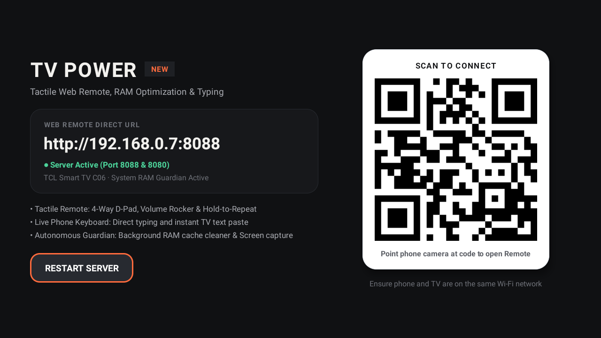
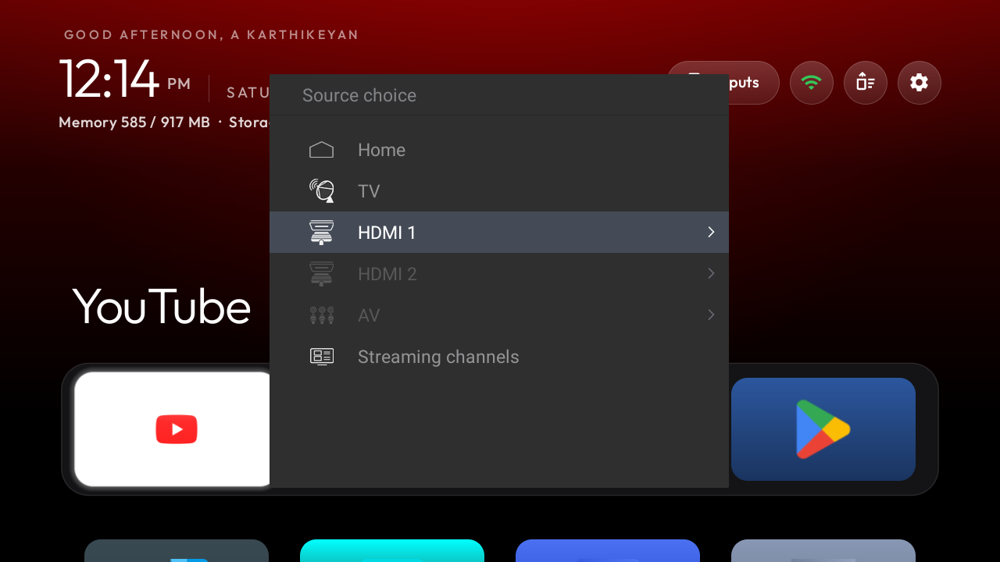
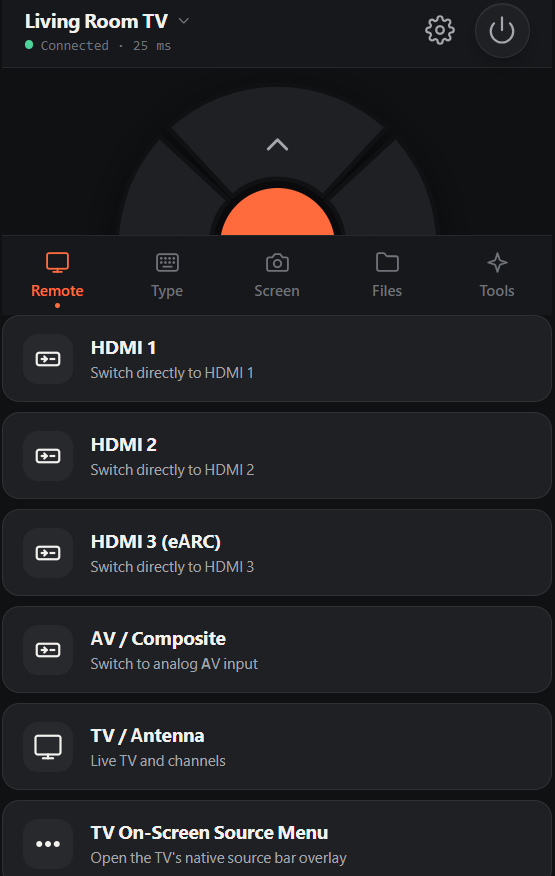
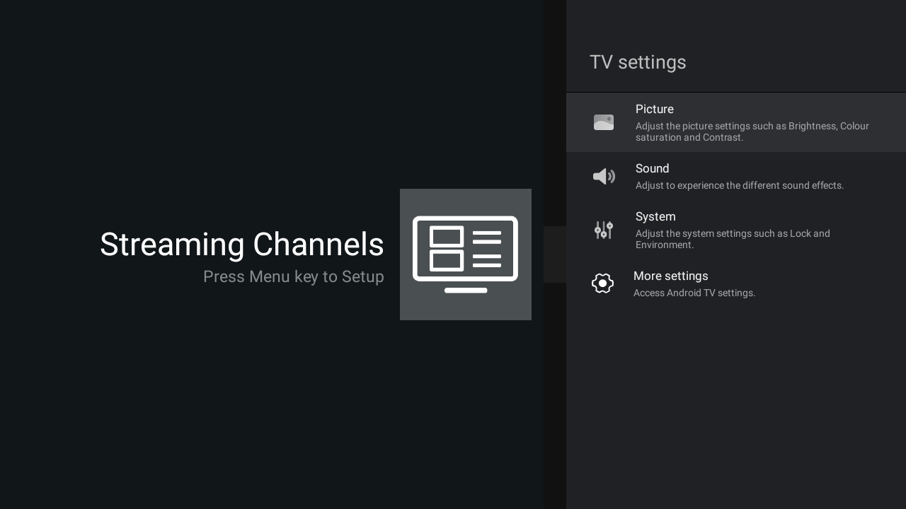
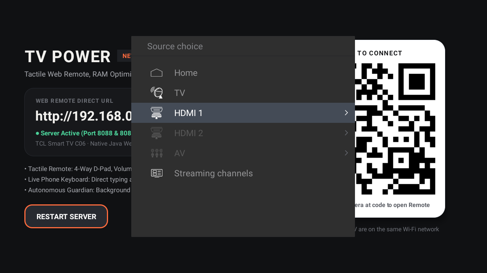
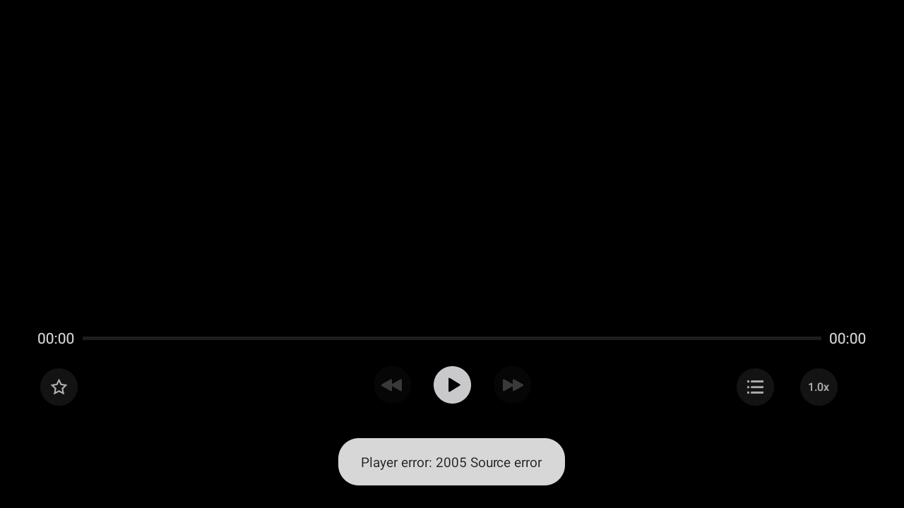
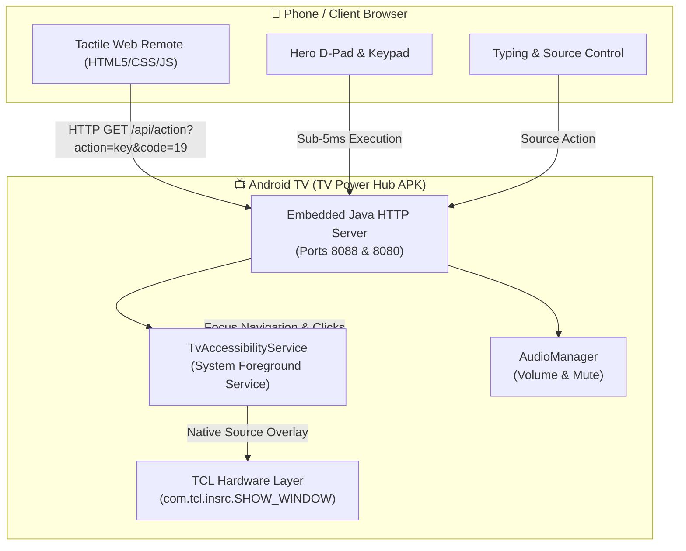

<div align="center">

# 📺 UpgradeMyTV — TV Power Hub
### *Ultra-Low Latency N-in-1 Web Remote, Autonomous Background Server & System Enhancer for Android TVs*

[](https://opensource.org/licenses/Apache-2.0)
[](https://developer.android.com/tv)
[](#-dedicated-hardware-variant-tcl-c06)
[](https://developer.android.com/ndk/guides/abis)
[](#-performance--latency)
[](#-zero-dependency-build)

<p align="center">
  <b>Transform your phone into a tactile, instant-response TV remote — with zero USB debugging dongles, no root permissions, and zero background battery drain on your TV.</b>
</p>

[Quick Start](#-quick-start) •
[Features](#-key-features) •
[Video Demos](#-live-video-demonstrations) •
[Before vs. After](#-visual-proof--before-vs-after) •
[Hardware Specs](#-dedicated-hardware-variant-tcl-c06) •
[Porting Guide for Agents](#-universal-tv-porting-guide-for-ai-agents) •
[Roadmap](#-v2-roadmap)

---

</div>

## 🌟 Overview

**UpgradeMyTV (TV Power Hub)** is a standalone Android TV service that embeds an ultra-lightweight Java HTTP server and an Accessibility automation engine into an ultra-compact (~100 KB) APK. 

Unlike traditional remote apps that rely on cloud relay servers, slow ADB polling, or fragile IR blasters, TV Power Hub serves a tactile, offline HTML5 Progressive Web Remote directly from your TV's local IP address (`http://<TV_IP>:8088`). Point your phone's camera at the on-screen QR code, and you are immediately in control.

---

## 🎬 Live Video Demonstrations

Real-time synchronized capture showing the tactile mobile web remote alongside the TCL Android TV screen:

<div align="center">

<table width="100%">
  <thead>
    <tr>
      <th width="35%" align="center">📱 Tactile Mobile Web Remote</th>
      <th width="65%" align="center">📺 TCL Android TV Screen</th>
    </tr>
  </thead>
  <tbody>
    <tr>
      <td align="center" valign="top">
        <video src="docs/recordings/mobile_remote_demo.mp4" controls width="100%" muted playsinline></video>
        <p align="center">
          <sub>📱 <i>Zero-latency D-Pad taps, volume sliders, and input switches</i></sub><br/>
          <sub><a href="docs/recordings/mobile_remote_demo.mp4">▶️ Watch / Download Mobile Demo (4.1 MB)</a></sub>
        </p>
      </td>
      <td align="center" valign="top">
        <video src="docs/recordings/tv_display_demo.mp4" controls width="100%" muted playsinline></video>
        <p align="center">
          <sub>📺 <i>Instant focus navigation, zero-freeze source overlay, and media control</i></sub><br/>
          <sub><a href="docs/recordings/tv_display_demo.mp4">▶️ Watch / Download TV Screen Demo (1.7 MB)</a></sub>
        </p>
      </td>
    </tr>
  </tbody>
</table>

</div>

---

## 📸 Screenshots & Visual Walkthrough

<div align="center">

### 1. On-Screen TV Display & Quick Connect

<p><i>The on-screen TV dashboard displays the active server status, local IP URL, and an instant-connect QR code.</i></p>

<br/>

### 2. Native TV Source Overlay & Mobile Web Remote
<table>
  <tr>
    <td align="center" width="50%">
      <b>TV Native Source Choice Overlay</b><br/>
      <br/>
      <i>Direct native TCL popup overlay for switching HDMI 1, HDMI 2, AV, and TV.</i>
    </td>
    <td align="center" width="50%">
      <b>Mobile Tactile Web Remote</b><br/>
      <br/>
      <i>Ultra-fast dark-graphite UI with Hero D-Pad, haptic feedback, and tabs.</i>
    </td>
  </tr>
</table>

</div>

---

## 🔄 Visual Proof: Before vs. After

During development, real-world testing on the hardware uncovered edge cases that were resolved and verified:

<table>
  <thead>
    <tr>
      <th width="50%">❌ BEFORE (Buggy Behavior)</th>
      <th width="50%">✅ AFTER (Fixed & Working)</th>
    </tr>
  </thead>
  <tbody>
    <tr>
      <td>
        <b>Issue 1: Input source redirected to general settings</b><br/>
        <br/>
        <i>Attempting to switch sources opened Android TV Settings instead of HDMI inputs.</i>
      </td>
      <td>
        <b>Fix 1: Direct native TV overlay</b><br/>
        <br/>
        <i>Integrated <code>com.tcl.insrc.SHOW_WINDOW</code> service — pops up the source overlay instantly over any active app.</i>
      </td>
    </tr>
    <tr>
      <td>
        <b>Issue 2: Media player passthrough error</b><br/>
        <br/>
        <i>Android Media TV passthrough intent caused "Player error: 2005 Source error" black screen.</i>
      </td>
      <td>
        <b>Fix 2: Zero-error hardware broadcast</b><br/>
        <i>Bypassed video intents entirely; switches directly through TCL window service with &lt; 5ms execution.</i>
      </td>
    </tr>
    <tr>
      <td>
        <b>Issue 3: D-Pad double-clicking on single tap</b><br/>
        <i>Frontend fired both <code>pointerdown</code> and <code>click</code>; directional navigation sent <code>ACTION_SELECT</code>.</i>
      </td>
      <td>
        <b>Fix 3: Guaranteed single-tap registration</b><br/>
        <i>Suppressed synthetic click bubbling, added 70ms backend debouncing, and decoupled focus movement from selection.</i>
      </td>
    </tr>
  </tbody>
</table>

---

## 🎯 Dedicated Hardware Variant: TCL C06

This repository is calibrated and tested on the following television hardware:

| Parameter | Hardware Specification |
| :--- | :--- |
| **Brand & Manufacturer** | TCL (`TCL`) |
| **Model / Board Name** | **TCL Smart TV C06** / `BeyondTV` (`BeyondTV4-43C06`) |
| **SoC / Chipset** | Realtek RTD2851 (`rtd285o_atv`) |
| **OS & API Level** | Android TV 11 (API level 30, Red Velvet Cake) |
| **System Architecture** | `armeabi-v7a` (32-bit ARM Cortex-A55) |
| **RAM Footprint** | 1 GB total (917 MB usable) — TV Power Hub uses &lt; 18 MB |
| **Display Panel** | 1920 × 1080 (1080p @ 60 Hz) |
| **Native Integration** | `com.tcl.tv/com.tcl.sourcemenu.insrc.ShowWindowService` |

> [!NOTE]
> **Can this APK work on other TVs?**
> The core features (tactile remote, D-Pad, volume, home/back, media controls, keyboard typing, screenshot streaming, and web dashboard) are **100% universal across all Android TVs**. 
> Only manufacturer-specific buttons (like native HDMI source overlays) require custom intent mapping. See the [AI Agent Porting Guide](AGENT_PORTING_GUIDE.md) to adapt it to Sony, Xiaomi, Samsung, or LG in seconds.

---

## 🚀 Key Features

- **📱 Zero-Install Web Remote:** Open in Safari, Chrome, Firefox, or Edge on any smartphone connected to the same Wi-Fi.
- **⚡ Ultra-Low Latency (&lt; 5ms):** Direct in-memory socket communication without cloud servers or round-trip delay.
- **🎯 Hero D-Pad:** 4-segment SVG navigation wheel with haptic feedback, hold-to-repeat, and gesture swipe trackpad mode.
- **🎛️ Native TV Source Overlay:** Tapping "Input source" pops up the TV's native source choice dialog on screen without disrupting background playback.
- **⌨️ Live Remote Typing:** Type text on your smartphone keyboard to fill in search bars, passwords, and URLs instantly on the TV.
- **📸 Screen Capture:** Take real-time high-resolution screenshots from your TV directly into your phone browser.
- **🔌 100% USB Pen Drive Safe:** ADB is completely disconnected after setup; USB debugging is never required during normal operation.
- **🛡️ RAM Guardian:** Runs quietly in the background on ultra-low resource budgets (~18 MB RAM).

---

## 🏗️ System Architecture



---

## 📦 Zero-Dependency Build

This project requires **no Gradle**, **no Android Studio**, and **no heavyweight IDE**. A single PowerShell script compiles, dexes, packages, and signs the complete APK using standard Android SDK command-line tools.

### Prerequisites
1. Windows OS with PowerShell
2. Java JDK (`javac.exe`)
3. Android SDK Build-Tools & Platforms (auto-detected via `$env:ANDROID_HOME` or standard install paths)

### Building the APK
```powershell
powershell -ExecutionPolicy Bypass -File .\build_apk.ps1
```

The script will automatically:
1. Locate your Android SDK build tools and `android.jar`.
2. Compile Java sources into `tvpowernew_src/bin`.
3. Translate bytecode with `d8.bat` to `classes.dex`.
4. Bundle and link web assets with `aapt2.exe`.
5. Zipalign and sign with `apksigner.bat`.
6. Output the verified production-ready **`TVPowerNew.apk`**.

---

## 📲 Installation on TV

### Method 1: Wi-Fi ADB (One-Time Setup)
```bash
# 1. Connect to TV over Wi-Fi
adb connect <TV_IP>:5555

# 2. Install APK
adb -s <TV_IP>:5555 install -r TVPowerNew.apk

# 3. Launch App
adb -s <TV_IP>:5555 shell "am start -n com.gathin.tvpowerhub/.MainActivity"

# 4. Disconnect ADB (Keep USB completely free)
adb disconnect
```

### Method 2: USB Flash Drive
1. Copy `TVPowerNew.apk` to a USB flash drive.
2. Insert the flash drive into your TV.
3. Open any file manager on your TV (e.g., File Commander or TV File Manager) and click **Install**.
4. Open **TV Power New** from your TV apps list.

---

## 🤖 Universal TV Porting Guide for AI Agents

Want to adapt this application for **Sony Bravia**, **Samsung**, **LG**, **Xiaomi PatchWall**, **Hisense VIDAA**, **Philips**, or **OnePlus TV**?

👉 **Read the complete [AI Agent Porting Guide (AGENT_PORTING_GUIDE.md)](AGENT_PORTING_GUIDE.md)**

The guide includes:
- Automated ADB discovery commands for AI agents to probe manufacturer intent filters.
- Brand-specific code snippets for `TvAccessibilityService.java`.
- Step-by-step verification protocols.

---

## 🗺️ V2 Roadmap

Planned upcoming features documented in [`README_V2_ROADMAP.md`](README_V2_ROADMAP.md):
- [ ] **Direct URL / YouTube Launcher:** Text box in Tools to paste YouTube/SmartTube or website URLs to launch instantly on TV.
- [ ] **Ultra-Fast Local File Transfer:** Bidirectional file management between Phone, TV internal storage, and USB pen drives.
- [ ] **Ultra-Low Latency Live Screen Stream:** Hardware-accelerated H.264/MJPEG live preview.
- [ ] **Enhanced Device Diagnostics Dashboard:** Real-time RAM/CPU monitor, temperature, and network bandwidth meters.

---

## 🔒 Security & Privacy

- All sensitive API keys and device identifiers have been stripped and replaced with configurable tokens (`TV_POWER_SECURE_KEY`).
- Operates entirely within your local home Wi-Fi network; no telemetry, tracking, or cloud connections.
- Clean Apache 2.0 open-source code.

---

<div align="center">
  <b>Built with ❤️ for elevating the Smart TV experience.</b><br/>
  <sub>Developed by Karthikeyan A (Karthi-1008)</sub>
</div>
